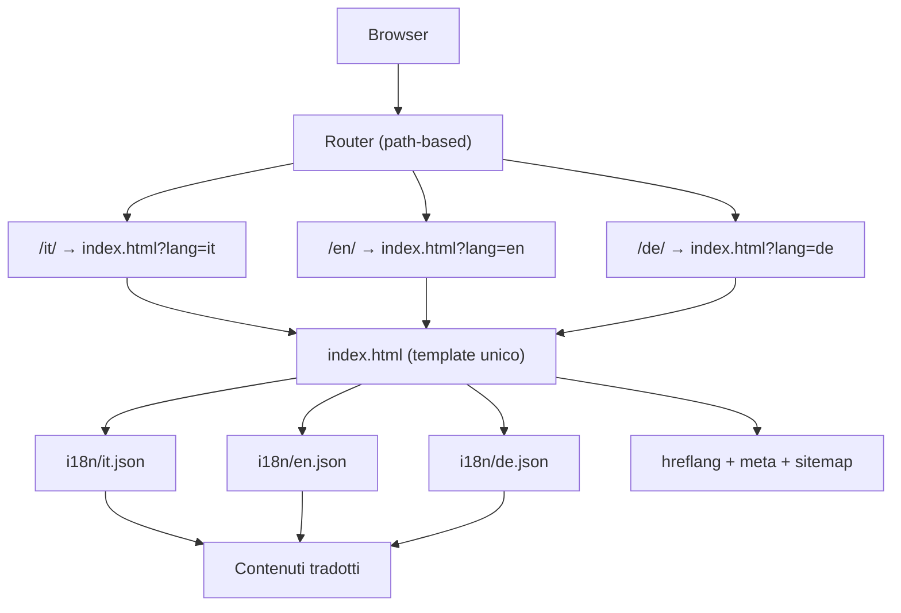

# ARCHITECTURE — gocilento.it v3 (multilingua + SEO)

## 1. Requirements summary

**Funzionali:**
- 3 lingue: IT (default), EN, DE
- 8 destinazioni, 4 esperienze, 4 stagioni, 3 itinerari, sapori, pratico — tutto tradotto
- Dropdown morphing, tabellone partenze, filtri, stagioni — tutto funzionante in ogni lingua
- Vetrina: niente prenotazioni, niente newsletter, niente servizi

**Non-funzionali:**
- SEO: hreflang, hreflang x-default, sitemap multilingua, meta tags per lingua
- Performance: <200KB propri, LCP <2.5s, animazioni GPU-friendly
- Accessibilità: skip-link, focus, reduced-motion, contrasti
- Manutenibilità: contenuti in file JSON separati, un solo template HTML

## 2. Architettura



## 3. Decisioni (ADR)

### ADR-001: sito statico, niente framework
Contesto: v1 informativa, nessun login/pagamento. Scelta: HTML+CSS+JS vanilla. Alternative: Next.js/Astro — scartate (build, costi, over-engineering). Conseguenze: +veloce, +manutenibile, −ricerca server e CMS (rinviati a v2 con file JSON).

### ADR-002: un solo CSS, un solo JS
Contesto: evitare frammentazione. Scelta: `styles.css` con token CSS + `app.js` unico. Alternative: split per pagina — inutile con una pagina. Conseguenze: facile revisione anti-slop.

### ADR-003: immagini remote Wikimedia Commons + Mixkit
Contesto: nessuna foto propria. Scelta: Wikimedia Commons (foto vere del Cilento, licenze libere) + Mixkit (video hero). Alternative: Unsplash — scartato (foto generiche, non verificabili). Conseguenze: foto reali e verificabili, crediti nel footer.

### ADR-004: meccanica dropdown morphing da pattern fornito nel brief
Contesto: il brief ha imposto la grammatica di interazione Halden. Scelta: meccanica adottata come idea funzionale, espressione interamente riscritta. Conseguenze: il file prototipo clone esatto è stato eliminato; resta solo l'implementazione cilentana.

### ADR-005: multilingua path-based (IT/EN/DE)
Contesto: il sito deve essere SEO-friendly in 3 lingue. Scelta: path-based (`/it/`, `/en/`, `/de/`) con `hreflang` e `x-default`. Alternative: sottodomini (`en.gocilento.it`) — scartato (costi DNS, certificati, duplicazione). Query string (`?lang=en`) — scartato (SEO debole, non indicizzabile separatamente). Conseguenze: +SEO ottimale, +condivisione URL, −routing server-side richiesto (risolto con rewrite rules o hosting statico con fallback).

### ADR-006: contenuti in JSON esterni — SUPERATA
Contesto (2026-10-08): si valutavano file `i18n/*.json` caricati via JS.
Superata: scelta finale = tre pagine HTML reali (`it/`, `en/`, `de/`), contenuto
nel markup, JS solo per comportamento. La cartella `i18n/` è stata eliminata:
era orfana (niente la caricava), ferma a 8 destinazioni e al vecchio brand.
Al suo posto: `api/*.json` generati dall'HTML (ADR-008), non il contrario.

### ADR-008: API per LLM generate dall'HTML
Contesto: gli LLM devono leggere e citare i contenuti in tutte le lingue.
Scelta: `api/{it,en,de}.json` + `llms.txt` + JSON-LD (`WebSite`, `TravelGuide`,
`ItemList` di 20 `TouristDestination`), tutti generati dall'HTML con
`tools/build-api.js`. L'HTML resta l'unica fonte di verità; i JSON non si
modificano a mano. `robots.txt` ammette esplicitamente i crawler AI.
Conseguenze: +contenuti citabili e verificabili, +nessuna deriva tra formati,
−rigenerare dopo ogni modifica ai testi.

**Stato del generatore.** `tools/build-api.js` ricostruisce `meta`, `hero`, `facts` e le 20 `destinations` dai tre `index.html`, verificato campo per campo contro i JSON esistenti. Le sezioni `seasons`, `verbs`, `itineraries`, `flavors`, `practical`, `tagline` e `legal` **non** sono ancora rigenerate: il generatore le preserva per non scrivere dati che non sa ricavare. Finche' non saranno coperte, modificarle nell'HTML richiede di aggiornare a mano il JSON. `llms.txt` e' scritto a mano.

### ADR-007: wordmark senza .eu
Contesto: il dominio potrebbe cambiare (.com, .it, ecc.). Scelta: wordmark `cilent` + o-arco, niente suffisso. Conseguenze: logo riusabile su qualsiasi dominio.

## 4. Struttura multilingua (vincolante)

```
gocilento.it/
  index.html              — redirect alla lingua (x-default)
  it/index.html           — home: hero, cifre, destinazioni, CTA, footer
  it/esperienze.html      — stagioni + verbi cilentani
  it/itinerari.html       — 3 itinerari onesti + CTA tailor-made
  it/info.html            — sapori + come arrivare
  (stessa struttura per en/ e de/)
  api/it.json …           — generati dall'HTML (ADR-008), mai a mano
  llms.txt                — indice per LLM
  404.html                — pagina non trovata trilingue
  styles.css              — design system
  app.js                  — solo comportamento, mai contenuti
  assets/
    logo.png (+ .webp)    — marchio CILENTO illustrato
    favicon.png, favicon-32.png, apple-touch-icon.png — dalla O del logo
    img/                  — foto locali verificate
  docs/
    ARCHITECTURE.md
    DESIGN.md
    ORIGINALITY.md
    CREDITS.md
  sitemap.xml             — sitemap multilingua con hreflang
  robots.txt              — crawler AI ammessi + sitemap
```

## 5. SEO multilingua


### ADR-009: motion cinematografico con librerie vendorizzate
Contesto: il sito aveva solo keyframe CSS e IntersectionObserver. Serviva un
linguaggio di movimento piu' ricco (testo mascherato, scroll morbido, pin,
hover magnetici, cursore) senza abbandonare il sito statico.
Scelta: GSAP 3.13 + ScrollTrigger + Lenis 1.3 in `assets/vendor/`, wiring
nostro in `assets/motion.js`. Alternative scartate:
- **Angular 17 + NgRx + signals** (`ng build`): abbatte ADR-001. Un SPA senza
  SSR non serve HTML statico ai crawler: perdiamo URL per lingua, hreflang,
  sitemap, JSON-LD e lo strato LLM generato dall'HTML (ADR-008). Con SSR si
  aggiunge build, non si toglie.
- **React/Vite/Tailwind/GSAP (spec Wanderful)**: stessa violazione, piu' asset
  di terzi non licenziati.
- **Motion solo con IntersectionObserver e CSS**: nessuna libreria, ma niente
  scroll morbido ne pin, e il risultato non e' quello richiesto.
Conseguenze: +146 KB (133 KB di librerie + 13 KB di wiring), tre richieste in
piu' ma locali e senza CDN, nessun processo di build, nessuna dipendenza da
installare. `prefers-reduced-motion` e l'assenza di JS lasciano la pagina
identica a prima: verificato che senza GSAP tutte le card restano visibili.

### hreflang (in `<head>` di index.html)
```html
<link rel="alternate" hreflang="it" href="https://gocilento.it/it/" />
<link rel="alternate" hreflang="en" href="https://gocilento.it/en/" />
<link rel="alternate" hreflang="de" href="https://gocilento.it/de/" />
<link rel="alternate" hreflang="x-default" href="https://gocilento.it/" />
```

### Meta tags dinamici
```html
<html lang="it">  <!-- o en, de -->
<title>GoCilento — ...</title>
<meta name="description" content="...">
```

### Sitemap multilingua
```xml
<urlset xmlns="http://www.sitemaps.org/schemas/sitemap/0.9"
        xmlns:xhtml="http://www.w3.org/1999/xhtml">
  <url>
    <loc>https://gocilento.it/it/</loc>
    <xhtml:link rel="alternate" hreflang="it" href="https://gocilento.it/it/"/>
    <xhtml:link rel="alternate" hreflang="en" href="https://gocilento.it/en/"/>
    <xhtml:link rel="alternate" hreflang="de" href="https://gocilento.it/de/"/>
    <xhtml:link rel="alternate" hreflang="x-default" href="https://gocilento.it/"/>
  </url>
  <!-- ... -->
</urlset>
```

## 6. Routing

### Opzione A: Path-based (consigliata)
- `/it/` → `index.html?lang=it`
- `/en/` → `index.html?lang=en`
- `/de/` → `index.html?lang=de`
- `/` → redirect a `/it/` (o content negotiation)

### Opzione B: Query string (fallback)
- `/?lang=it`, `/?lang=en`, `/?lang=de`

### Implementazione
```javascript
// app.js
const params = new URLSearchParams(window.location.search);
const lang = params.get('lang') || 'it';
const validLangs = ['it', 'en', 'de'];
const currentLang = validLangs.includes(lang) ? lang : 'it';

// Carica i18n
import(`./i18n/${currentLang}.json`).then(data => {
  render(data);
  updateMeta(currentLang);
  updateHreflang(currentLang);
});
```

## 7. Animazioni lente e piacevoli

- `heroIn` 2.4s: scale 1.08→1, brightness .6→1
- `fadeUp` 1s con delay .9s per scroll cue
- `reveal` on scroll: opacity 0→1, translateY 18px→0, 0.6s
- Hover: translateY(-4px), 0.25s
- Dropdown morph: 0.5s cubic-bezier(.22,1,.36,1)
- Tutte GPU-friendly (transform + opacity only)
- `prefers-reduced-motion`: tutte disattivate

## 8. Rischi

- **Foto evocative scambiate per reali** → mitigato con Wikimedia Commons verificate
- **Video hero non Cilento** → dichiarato nel footer come "tramonto generico"
- **Traduzioni imprecise** → revisione madrelingua richiesta prima del lancio
- **Routing multilingua su hosting statico** → risolto con `_redirects` o rewrite rules
- **SEO multilingua** → hreflang + sitemap + meta dinamici

## 9. Prossimi passi

1. Creare `i18n/it.json` con tutti i contenuti IT
2. Creare `i18n/en.json` e `i18n/de.json` con traduzioni
3. Implementare il rendering dinamico in `app.js`
4. Aggiungere hreflang e meta dinamici
5. Creare `sitemap.xml` multilingua
6. Testare le 3 lingue end-to-end

### ADR-010: scena 3D del percorso, caricata solo se serve
Contesto: la home doveva mostrare le 20 localita' come un viaggio, non come
una lista. Un canvas e' la strada naturale, ma costa.
Scelta: Three.js r171 vendorizzato in `assets/vendor/`, modulo `assets/journey.js`,
caricato con `import()` dinamico **solo** quando la sezione arriva a 400px dal
bordo. Conseguenze misurate:
- al caricamento della home: **0 byte** di Three.js, script totale 151 KB gzip
- quando la sezione entra in vista: **689 KB** di script (Three.js 占 78,7 KB gzip
  ma i due file insieme sono ~700 KB lordi), piu' le texture
- non e' un build step: i file sono ESM serviti cosi' come sono

Alternative scartate:
- **Linea 2D in SVG** (~8 KB): molto piu' leggera, ma non dava la profondita' richiesta.
- **CSS 3D**: nessuna liberta' su camere e luci.

Regole che il modulo deve rispettare, e che non sono negoziabili:
1. **I dati non sono duplicati.** Le fermate sono lette dalle card `.dest` che sono
   gia' in pagina: nessun elenco scritto due volte che possa andare fuori sincrono.
2. **Le 8 localita' senza foto restano senza foto.** Hanno un segnaposto diverso,
   dichiarato anche nel testo della sezione. Nessuna immagine stock di riempimento.
3. **Fallback reale.** Senza WebGL o con `prefers-reduced-motion` non si carica
   niente e resta la lista dei 12 fermate con link veri.
4. **Si ferma quando non serve.** `IntersectionObserver` + pausa su tab nascosto.
5. **Rete di sicurezza sul trigger**: se l'osservatore resta sospeso, basta uno
   scroll. Senza, la sezione potrebbe non apparire mai.
