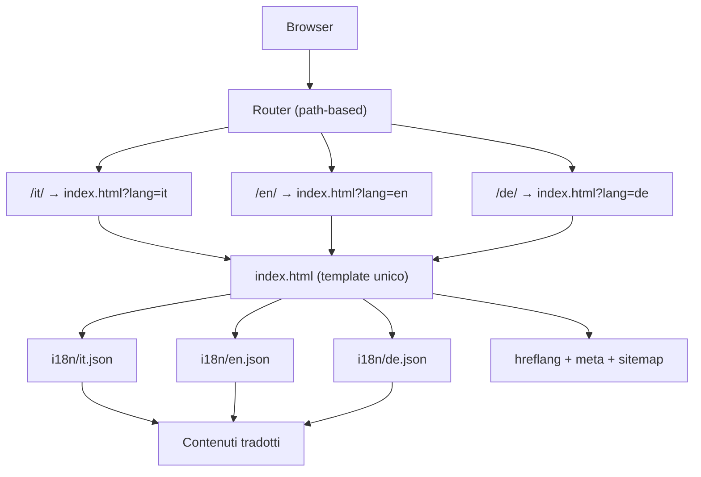

# ARCHITECTURE — gocilento.it v3 (multilingua + SEO)

## 1. Requirements summary

**Funzionali:**
- 3 lingue: IT (default), EN, DE
- 8 destinazioni, 4 esperienze, 4 stagioni, 3 itinerari, sapori, pratico — tutto tradotto
- Dropdown morphing, tabellone partenze, filtri, stagioni — tutto funzionante in ogni lingua
- Vetrina: niente prenotazioni, niente newsletter, niente servizi

**Non-funzionali:**
- SEO: hreflang, hreflang x-default, sitemap multilingua, meta tags per lingua
- Performance: <200KB propri, LCP <2.5s, animazioni GPU-friendly
- Accessibilità: skip-link, focus, reduced-motion, contrasti
- Manutenibilità: contenuti in file JSON separati, un solo template HTML

## 2. Architettura



## 3. Decisioni (ADR)

### ADR-001: sito statico, niente framework
Contesto: v1 informativa, nessun login/pagamento. Scelta: HTML+CSS+JS vanilla. Alternative: Next.js/Astro — scartate (build, costi, over-engineering). Conseguenze: +veloce, +manutenibile, −ricerca server e CMS (rinviati a v2 con file JSON).

### ADR-002: un solo CSS, un solo JS
Contesto: evitare frammentazione. Scelta: `styles.css` con token CSS + `app.js` unico. Alternative: split per pagina — inutile con una pagina. Conseguenze: facile revisione anti-slop.

### ADR-003: immagini remote Wikimedia Commons + Mixkit
Contesto: nessuna foto propria. Scelta: Wikimedia Commons (foto vere del Cilento, licenze libere) + Mixkit (video hero). Alternative: Unsplash — scartato (foto generiche, non verificabili). Conseguenze: foto reali e verificabili, crediti nel footer.

### ADR-004: meccanica dropdown morphing da pattern fornito nel brief
Contesto: il brief ha imposto la grammatica di interazione Halden. Scelta: meccanica adottata come idea funzionale, espressione interamente riscritta. Conseguenze: il file prototipo clone esatto è stato eliminato; resta solo l'implementazione cilentana.

### ADR-005: multilingua path-based (IT/EN/DE)
Contesto: il sito deve essere SEO-friendly in 3 lingue. Scelta: path-based (`/it/`, `/en/`, `/de/`) con `hreflang` e `x-default`. Alternative: sottodomini (`en.gocilento.it`) — scartato (costi DNS, certificati, duplicazione). Query string (`?lang=en`) — scartato (SEO debole, non indicizzabile separatamente). Conseguenze: +SEO ottimale, +condivisione URL, −routing server-side richiesto (risolto con rewrite rules o hosting statico con fallback).

### ADR-006: contenuti in JSON esterni
Contesto: 3 lingue × 8 destinazioni + sezioni = molte stringhe. Scelta: file `i18n/{it,en,de}.json` caricati dinamicamente. Alternative: duplicare l'HTML per lingua — scartato (manutenibilità disastrosa, 3× bug). Conseguenze: +manutenibile, +scalabile, −richiede JS per il rendering (mitigato con fallback server-side o build-time).

### ADR-007: wordmark senza .eu
Contesto: il dominio potrebbe cambiare (.com, .it, ecc.). Scelta: wordmark `cilent` + o-arco, niente suffisso. Conseguenze: logo riusabile su qualsiasi dominio.

## 4. Struttura multilingua (vincolante)

```
gocilento.it/
  index.html              — template unico, legge ?lang= o path
  styles.css              — design system
  app.js                  — rendering + routing + i18n
  i18n/
    it.json               — contenuti IT (default)
    en.json               — contenuti EN
    de.json               — contenuti DE
  assets/
    logo.svg              — emblema o-arco
    favicon.svg           — favicon
  docs/
    ARCHITECTURE.md
    DESIGN.md
    ORIGINALITY.md
  _redirects              — hosting statico: /it → /?lang=it, /en → /?lang=en, /de → /?lang=de
  sitemap.xml             — sitemap multilingua con hreflang
```

## 5. SEO multilingua

### hreflang (in `<head>` di index.html)
```html
<link rel="alternate" hreflang="it" href="https://gocilento.it/it/" />
<link rel="alternate" hreflang="en" href="https://gocilento.it/en/" />
<link rel="alternate" hreflang="de" href="https://gocilento.it/de/" />
<link rel="alternate" hreflang="x-default" href="https://gocilento.it/" />
```

### Meta tags dinamici
```html
<html lang="it">  <!-- o en, de -->
<title>GoCilento — ...</title>
<meta name="description" content="...">
```

### Sitemap multilingua
```xml
<urlset xmlns="http://www.sitemaps.org/schemas/sitemap/0.9"
        xmlns:xhtml="http://www.w3.org/1999/xhtml">
  <url>
    <loc>https://gocilento.it/it/</loc>
    <xhtml:link rel="alternate" hreflang="it" href="https://gocilento.it/it/"/>
    <xhtml:link rel="alternate" hreflang="en" href="https://gocilento.it/en/"/>
    <xhtml:link rel="alternate" hreflang="de" href="https://gocilento.it/de/"/>
    <xhtml:link rel="alternate" hreflang="x-default" href="https://gocilento.it/"/>
  </url>
  <!-- ... -->
</urlset>
```

## 6. Routing

### Opzione A: Path-based (consigliata)
- `/it/` → `index.html?lang=it`
- `/en/` → `index.html?lang=en`
- `/de/` → `index.html?lang=de`
- `/` → redirect a `/it/` (o content negotiation)

### Opzione B: Query string (fallback)
- `/?lang=it`, `/?lang=en`, `/?lang=de`

### Implementazione
```javascript
// app.js
const params = new URLSearchParams(window.location.search);
const lang = params.get('lang') || 'it';
const validLangs = ['it', 'en', 'de'];
const currentLang = validLangs.includes(lang) ? lang : 'it';

// Carica i18n
import(`./i18n/${currentLang}.json`).then(data => {
  render(data);
  updateMeta(currentLang);
  updateHreflang(currentLang);
});
```

## 7. Animazioni lente e piacevoli

- `heroIn` 2.4s: scale 1.08→1, brightness .6→1
- `fadeUp` 1s con delay .9s per scroll cue
- `reveal` on scroll: opacity 0→1, translateY 18px→0, 0.6s
- Hover: translateY(-4px), 0.25s
- Dropdown morph: 0.5s cubic-bezier(.22,1,.36,1)
- Tutte GPU-friendly (transform + opacity only)
- `prefers-reduced-motion`: tutte disattivate

## 8. Rischi

- **Foto evocative scambiate per reali** → mitigato con Wikimedia Commons verificate
- **Video hero non Cilento** → dichiarato nel footer come "tramonto generico"
- **Traduzioni imprecise** → revisione madrelingua richiesta prima del lancio
- **Routing multilingua su hosting statico** → risolto con `_redirects` o rewrite rules
- **SEO multilingua** → hreflang + sitemap + meta dinamici

## 9. Prossimi passi

1. Creare `i18n/it.json` con tutti i contenuti IT
2. Creare `i18n/en.json` e `i18n/de.json` con traduzioni
3. Implementare il rendering dinamico in `app.js`
4. Aggiungere hreflang e meta dinamici
5. Creare `sitemap.xml` multilingua
6. Testare le 3 lingue end-to-end
